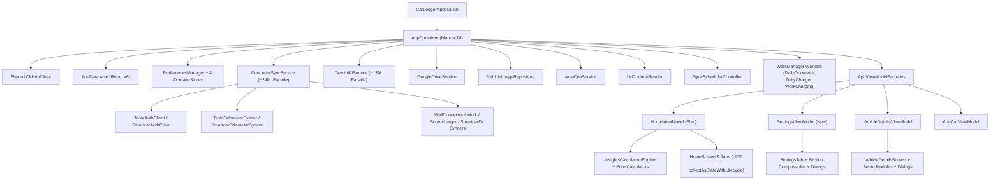

# Android Architecture Modernization & Large-File Refactoring Implementation Plan

> **For agentic workers:** Execute this plan task-by-task on a dedicated feature branch or git worktree (never directly on `main`). Steps use checkbox (`- [ ]`) syntax for tracking. Run `./gradlew testDebugUnitTest assembleDebug` after every task before committing.

**Goal:** Align **Garage Journal** (`com.example.car_logger`) with official [Android Architecture Recommendations](https://developer.android.com/topic/architecture/recommendations) and [Jetpack Compose UI Architecture](https://developer.android.com/develop/ui/compose/architecture) best practices, eliminate all >1,000-line production files (Phase 1) and 700–950-line second-tier files (Phase 2), and target **< 450 lines per production Kotlin file** with zero behavioral or data regressions.

**Architecture:**
- **Manual DI via `AppContainer`** owned by `CarLoggerApplication` (zero new Gradle plugins/dependencies): shares a single `OkHttpClient`, `AppDatabase`, `PreferencesManager`, `OdometerSyncService`, `GeminiAiService`, `GoogleDriveService`, `VehicleImageRepository`, and `AutoDevService` across ViewModels and WorkManager workers, removing `AndroidViewModel`.
- **Lifecycle-aware UDF**: Migrate all 79 `collectAsState()` calls to `collectAsStateWithLifecycle()`, encapsulate all public `MutableStateFlow`s, replace manual `LifecycleEventObserver` with `LifecycleResumeEffect`, introduce `SettingsViewModel` + `SettingsUiState`, and extract plain Compose state holders for complex bottom sheets.
- **Modular decomposition behind stable facades**: Split `OdometerSyncService` (4,020 lines) into focused collaborators under `services/telemetry/`, `InsightsCalculationEngine` (1,267 lines) into pure calculators under `data/insights/`, `PreferencesManager` (790 lines) into domain preference stores under `data/local/prefs/`, and `GeminiAiService` (720 lines) into focused services under `services/ai/` while removing the deprecated `com.google.ai.client.generativeai` SDK.

**Tech Stack:** Kotlin 2.2.20, Jetpack Compose (BOM 2026.09.00, Material 3 Expressive 1.5.0-rc01), Lifecycle Runtime Compose, Room v6, DataStore Preferences, OkHttp 4, Kotlinx Serialization, WorkManager 2.10, JUnit4, Kotlinx Coroutines Test.

**Related ADRs & Rules:**
- `docs/adr/0001-variable-blended-utility-rate-and-historical-bill-matching.md`
- `docs/adr/0002-hybrid-vehicle-attribution-for-shared-ev-chargers.md`
- `AGENTS.md` (worktree setup via `./scripts/setup_worktree.sh`; verify with `./gradlew testDebugUnitTest assembleDebug`)

---

## Global Constraints

1. **Git Isolation (Never Directly on `main`)**:
   - All work must happen on `refactor/android-architecture-modularization` (or a dedicated `git worktree` branched from it).
   - If using a new `git worktree`, run `./scripts/setup_worktree.sh` first so gitignored `app/google-services.json` and `local.properties` are copied before invoking `./gradlew`.
2. **Zero Data or Schema Breaking Changes**:
   - **Room schema v6** (`app/src/main/kotlin/com/example/car_logger/data/local/AppDatabase.kt`) must remain untouched.
   - **All DataStore preference key strings** in `PreferencesManager.kt` must remain byte-for-byte identical.
   - **ADR 0001** (variable blended utility rate & chronological bill matching) and **ADR 0002** (hybrid shared EV charger attribution) behavior must remain strictly identical.
3. **Zero Weakened Tests**:
   - Every existing assertion across all 22 unit test suites must continue to pass (migrated cleanly when giant test suites are split by domain).
4. **Confirmed Phase 2 Fixes Included**:
   - **Fix `MaintenanceRecordDialog` deletion** in `MainActivity.kt` by wiring `onDelete` to `homeViewModel.deleteMaintenanceRecord(recordId)`.
   - **Remove deprecated `com.google.ai.client.generativeai` SDK** by migrating `parseReceipt` onto `GeminiHttpClient.executeMultimodalJsonRequest` (also unlocking PDF receipt parsing without `BitmapFactory` memory overhead) and cleaning up `app/build.gradle.kts`, `gradle/libs.versions.toml`, and `app/proguard-rules.pro`.

---

## Target Architecture Diagram



---

## Target File Size Summary

| Source File | Baseline Lines | Phase / Task | Target Max Lines / File |
|---|---:|---|---:|
| `services/OdometerSyncService.kt` | 4,020 | 1B / Task 4 | ~240 (facade) + 11 modules (150–380 each) |
| `ui/screens/home/tabs/SettingsTab.kt` | 2,731 | 1B / Task 5 | ~190 (tab) + ViewModel + 8 sub-files (120–300 each) |
| `test/.../OdometerSyncServiceTest.kt` | 2,314 | 1B / Task 4 | 7 domain test files + fixtures (200–450 each) |
| `ui/screens/vehicledetails/components/VehicleInsightsBentoGrid.kt` | 1,462 | 1B / Task 6 | ~170 (grid) + 5 tile/drawer files (130–320 each) |
| `data/insights/InsightsCalculationEngine.kt` | 1,267 | 1B / Task 7 | ~260 (engine) + 4 pure calculators (80–420 each) |
| `test/.../EvElectricityCostAnalysisTest.kt` | 1,231 | 1B / Task 7 | 3 focused test suites (250–400 each) |
| `ui/screens/home/tabs/insights/EvElectricityCostCard.kt` | 1,187 | 1B / Task 8 | ~190 (card) + 4 component files (110–350 each) |
| `ui/screens/home/tabs/insights/ChargerUsageReviewSheet.kt` | 946 | 2 / Task 10 | ~210 (sheet) + state holder + 2 content files |
| `ui/screens/home/tabs/insights/UtilityBillReviewSheet.kt` | 847 | 2 / Task 10 | ~280 (sheet) + state holder + breakdown card |
| `ui/screens/home/HomeViewModel.kt` | 822 | 2 / Task 9 | ~260 (VM) + 3 coordinators/calculators |
| `data/local/PreferencesManager.kt` | 790 | 2 / Task 11 | ~200 (facade) + 4 domain stores |
| `ui/screens/vehicledetails/VehicleDetailsScreen.kt` | 721 | 2 / Task 12 | ~280 (screen) + extracted dialogs |
| `services/GeminiAiService.kt` | 720 | 2 / Task 13 | ~130 (facade) + 4 AI modules (SDK removed) |
| `ui/screens/home/tabs/InsightsTab.kt` | 704 | 2 / Task 14 | ~280 (tab) + `InsightsActions` + header controls |

---

## Phase 1A: Cross-Cutting Android Architecture Foundations

### Task 1: Manual DI (`AppContainer`) & Remove `AndroidViewModel`

**Files:**
- Create: `app/src/main/kotlin/com/example/car_logger/di/AppContainer.kt`
- Create: `app/src/main/kotlin/com/example/car_logger/di/AppViewModelFactories.kt`
- Create: `app/src/main/kotlin/com/example/car_logger/data/local/UriContentReader.kt`
- Create: `app/src/main/kotlin/com/example/car_logger/services/SyncSchedulerController.kt`
- Modify: `app/src/main/kotlin/com/example/car_logger/CarLoggerApplication.kt`
- Modify: `app/src/main/kotlin/com/example/car_logger/MainActivity.kt`
- Modify: `app/src/main/kotlin/com/example/car_logger/services/AutoDevService.kt`
- Modify: `app/src/main/kotlin/com/example/car_logger/services/DailyOdometerSyncWorker.kt`
- Modify: `app/src/main/kotlin/com/example/car_logger/services/DailyChargerSyncWorker.kt`
- Modify: `app/src/main/kotlin/com/example/car_logger/services/WorkChargingSyncWorker.kt`
- Modify: `app/src/main/kotlin/com/example/car_logger/ui/screens/home/HomeViewModel.kt`
- Modify: `app/src/main/kotlin/com/example/car_logger/ui/screens/vehicledetails/VehicleDetailsViewModel.kt`
- Modify: `app/src/main/kotlin/com/example/car_logger/ui/screens/addcar/AddCarViewModel.kt`

**Steps:**
- [ ] Create `UriContentReader` (interface + `AndroidUriContentReader(appContext)`) moving `resolveFileName`, `resolveMimeType`, and `readBytes` out of `HomeViewModel`.
- [ ] Create `SyncSchedulerController` (interface + `AndroidSyncSchedulerController(appContext)`) wrapping `DailyPollScheduler`, `ChargerSyncScheduler`, and `WorkChargingSyncScheduler` so ViewModels never hold a `Context`.
- [ ] Update `AutoDevService` constructor to accept `client: OkHttpClient = defaultClient` so it shares the container's `OkHttpClient`.
- [ ] Create `AppContainer(appContext: Context)` lazily instantiating one shared `OkHttpClient`, `AppDatabase`, `PreferencesManager`, `GoogleDriveService`, `VehicleImageRepository`, `AutoDevService`, `GeminiAiService`, `OdometerSyncService`, `UriContentReader`, and `SyncSchedulerController`.
- [ ] Expose `lateinit var container: AppContainer` on `CarLoggerApplication` (keeping `database` and `preferencesManager` delegating to `container`).
- [ ] Update all 3 WorkManager workers to pull shared dependencies from `(applicationContext as? CarLoggerApplication)?.container` with safe fallback for `TestListenableWorkerBuilder`.
- [ ] Convert `HomeViewModel`, `VehicleDetailsViewModel`, and `AddCarViewModel` from `AndroidViewModel` to plain `ViewModel` with constructor-injected dependencies, wired through `AppViewModelFactories` in `MainActivity`.
- [ ] Verify: `./gradlew testDebugUnitTest assembleDebug` and `rg -n "AndroidViewModel" app/src/main/kotlin` returns zero matches.

---

### Task 2: Lifecycle-Aware State Collection & ViewModel UDF Encapsulation

**Files:**
- Modify: `app/src/main/kotlin/com/example/car_logger/MainActivity.kt`
- Modify: `app/src/main/kotlin/com/example/car_logger/ui/screens/home/HomeScreen.kt`
- Modify: `app/src/main/kotlin/com/example/car_logger/ui/screens/home/HomeViewModel.kt`
- Modify: `app/src/main/kotlin/com/example/car_logger/ui/screens/home/tabs/SettingsTab.kt`
- Modify: `app/src/main/kotlin/com/example/car_logger/ui/screens/vehicledetails/VehicleDetailsScreen.kt`
- Modify: `app/src/main/kotlin/com/example/car_logger/ui/screens/vehicledetails/VehicleDetailsViewModel.kt`
- Modify: `app/src/main/kotlin/com/example/car_logger/ui/screens/vehicledetails/tabs/GloveboxTab.kt`
- Modify: `app/src/main/kotlin/com/example/car_logger/ui/screens/addcar/AddCarModalSheet.kt`
- Modify: `app/src/main/kotlin/com/example/car_logger/ui/screens/addcar/AddCarViewModel.kt`

**Steps:**
- [ ] Replace all **79** `collectAsState(...)` calls across the 6 UI files with `androidx.lifecycle.compose.collectAsStateWithLifecycle(...)`.
- [ ] Encapsulate all public `MutableStateFlow` properties in `HomeViewModel`, `VehicleDetailsViewModel`, and `AddCarViewModel` behind private `_field` + public `val field: StateFlow<T> = _field.asStateFlow()` with explicit intent setter methods where needed (e.g., `AddCarViewModel` form field setters).
- [ ] Remove redundant `.combine(currentTab)` on `cars`, `allRecords`, and `hasUrgentService` in `HomeViewModel.kt` (replace with `.map { ... }`).
- [ ] Verify: `./gradlew testDebugUnitTest assembleDebug` and `rg -n "collectAsState\(" app/src/main/kotlin` returns zero matches.

---

### Task 3: Centralize Duplicated Semantic Theme Tokens

**Files:**
- Modify: `app/src/main/kotlin/com/example/car_logger/ui/theme/Color.kt`
- Modify: `app/src/main/kotlin/com/example/car_logger/ui/theme/Theme.kt`
- Modify: `app/src/main/kotlin/com/example/car_logger/ui/screens/home/tabs/insights/GasComparisonCard.kt`
- Modify: `app/src/main/kotlin/com/example/car_logger/ui/screens/home/tabs/insights/EvElectricityCostCard.kt`
- Modify: `app/src/main/kotlin/com/example/car_logger/ui/screens/home/tabs/insights/PeriodChargingLogsSheet.kt`
- Modify: `app/src/main/kotlin/com/example/car_logger/ui/screens/home/tabs/insights/ChargerUsageReviewSheet.kt`
- Modify: `app/src/main/kotlin/com/example/car_logger/ui/screens/vehicledetails/components/VehicleInsightsBentoGrid.kt`
- Modify: `app/src/main/kotlin/com/example/car_logger/ui/screens/home/tabs/SettingsTab.kt`

**Steps:**
- [ ] Add light/dark savings & workplace green constants to `Color.kt` (`SavingsContainerLight`/`Dark`, `SavingsAccentLight`/`Dark`, `SavingsTextLight`/`Dark`, `WorkIconContainerLight`/`Dark`, `WorkIconTintLight`/`Dark`).
- [ ] Expose `@Composable @ReadOnlyComposable` semantic properties on `ExpressiveThemeTokens` in `Theme.kt`.
- [ ] Replace the 6 hardcoded `isSystemInDarkTheme()` hex color blocks across the UI files with `ExpressiveThemeTokens.*`.
- [ ] Verify: `./gradlew testDebugUnitTest assembleDebug`.

---

## Phase 1B: Decomposing All 5 Production Files Over 1,000 Lines

### Task 4: Decompose `OdometerSyncService.kt` (4,020 Lines) & Split `OdometerSyncServiceTest.kt` (2,314 Lines)

**Files:**
- Create: `app/src/main/kotlin/com/example/car_logger/services/TelemetryModels.kt`
- Create: `app/src/main/kotlin/com/example/car_logger/services/telemetry/TelemetryJsonUtils.kt`
- Create: `app/src/main/kotlin/com/example/car_logger/services/telemetry/TeslaAuthClient.kt`
- Create: `app/src/main/kotlin/com/example/car_logger/services/telemetry/SmartcarAuthClient.kt`
- Create: `app/src/main/kotlin/com/example/car_logger/services/telemetry/TeslaOdometerSyncer.kt`
- Create: `app/src/main/kotlin/com/example/car_logger/services/telemetry/SmartcarOdometerSyncer.kt`
- Create: `app/src/main/kotlin/com/example/car_logger/services/telemetry/WallConnectorParser.kt`
- Create: `app/src/main/kotlin/com/example/car_logger/services/telemetry/WallConnectorSyncer.kt`
- Create: `app/src/main/kotlin/com/example/car_logger/services/telemetry/TeslaWorkChargingSyncer.kt`
- Create: `app/src/main/kotlin/com/example/car_logger/services/telemetry/TeslaSuperchargerSyncer.kt`
- Create: `app/src/main/kotlin/com/example/car_logger/services/telemetry/SmartcarDcChargingSyncer.kt`
- Create: `app/src/main/kotlin/com/example/car_logger/services/telemetry/TelemetryStatusFormatters.kt`
- Modify: `app/src/main/kotlin/com/example/car_logger/services/OdometerSyncService.kt` (4,020 → ~240 lines facade)
- Replace `app/src/test/kotlin/com/example/car_logger/OdometerSyncServiceTest.kt` (2,314 lines) with:
  - `app/src/test/kotlin/com/example/car_logger/telemetry/TelemetryTestFixtures.kt`
  - `app/src/test/kotlin/com/example/car_logger/telemetry/OdometerSyncCoreTest.kt`
  - `app/src/test/kotlin/com/example/car_logger/telemetry/TeslaOAuthAndOdometerTest.kt`
  - `app/src/test/kotlin/com/example/car_logger/telemetry/SmartcarOAuthAndOdometerTest.kt`
  - `app/src/test/kotlin/com/example/car_logger/telemetry/WallConnectorSyncTest.kt`
  - `app/src/test/kotlin/com/example/car_logger/telemetry/TeslaWorkChargingSyncTest.kt`
  - `app/src/test/kotlin/com/example/car_logger/telemetry/TeslaSuperchargerSyncTest.kt`
  - `app/src/test/kotlin/com/example/car_logger/telemetry/SmartcarDcChargingSyncTest.kt`

**Steps:**
- [ ] Extract all public data classes and sealed result hierarchies (lines 60–223) into `services/TelemetryModels.kt` (keeping `package com.example.car_logger.services` so no callers break).
- [ ] Extract JSON helpers, JWT parsers (`parseJwtClaims`, `extractJwtExpiryMs`, `extractJwtScopes`, `hasTeslaLocationScope`, `hasTeslaChargingHistoryScope`), flexible timestamp/duration parsers, `haversineMeters`, cooldown math, `formatRelativeTime`, `shouldRecordOdometerLog`, `resolveProviderForCar`, and `recordOdometerReading` into `services/telemetry/TelemetryJsonUtils.kt`.
- [ ] Extract `TeslaAuthClient` and `SmartcarAuthClient` (OAuth URLs, credentials, code exchange, token refresh, authenticated HTTP helpers, error parsers).
- [ ] Extract `TeslaOdometerSyncer` and `SmartcarOdometerSyncer`.
- [ ] Extract `WallConnectorParser` and `WallConnectorSyncer`.
- [ ] Extract `TeslaWorkChargingSyncer`, `TeslaSuperchargerSyncer`, `SmartcarDcChargingSyncer`, and `TelemetryStatusFormatters`.
- [ ] Slim `OdometerSyncService.kt` down to a ~240-line facade composing the collaborators with the injected `OkHttpClient`, owning `isSyncing`/`lastSyncMessage`, and keeping delegating `companion object` helpers for backwards compatibility.
- [ ] Split `OdometerSyncServiceTest.kt` into `TelemetryTestFixtures.kt` + 7 domain test files with zero dropped test cases.
- [ ] Verify: `./gradlew testDebugUnitTest assembleDebug` and check every new telemetry file is < 400 lines.

---

### Task 5: Decompose `SettingsTab.kt` (2,731 Lines) & Introduce `SettingsViewModel`

**Files:**
- Create: `app/src/main/kotlin/com/example/car_logger/ui/screens/home/tabs/settings/SettingsUiState.kt`
- Create: `app/src/main/kotlin/com/example/car_logger/ui/screens/home/tabs/settings/SettingsViewModel.kt`
- Create: `app/src/main/kotlin/com/example/car_logger/ui/screens/home/tabs/settings/SettingsSyncFormatters.kt`
- Create: `app/src/main/kotlin/com/example/car_logger/ui/screens/home/tabs/settings/SettingsCommonComponents.kt`
- Create: `app/src/main/kotlin/com/example/car_logger/ui/screens/home/tabs/settings/SettingsCredentialDialogs.kt`
- Create: `app/src/main/kotlin/com/example/car_logger/ui/screens/home/tabs/settings/SettingsSyncDialogs.kt`
- Create: `app/src/main/kotlin/com/example/car_logger/ui/screens/home/tabs/settings/VehicleSyncSettingsSection.kt`
- Create: `app/src/main/kotlin/com/example/car_logger/ui/screens/home/tabs/settings/HomeChargingSettingsSection.kt`
- Create: `app/src/main/kotlin/com/example/car_logger/ui/screens/home/tabs/settings/WorkChargingSettingsSection.kt`
- Create: `app/src/main/kotlin/com/example/car_logger/ui/screens/home/tabs/settings/PublicChargingSettingsSection.kt`
- Create: `app/src/main/kotlin/com/example/car_logger/ui/screens/home/tabs/settings/GeneralBackupApiSettingsSections.kt`
- Modify: `app/src/main/kotlin/com/example/car_logger/ui/screens/home/tabs/SettingsTab.kt` (2,731 → ~190 lines)
- Modify: `app/src/main/kotlin/com/example/car_logger/ui/screens/home/HomeScreen.kt`
- Modify: `app/src/main/kotlin/com/example/car_logger/di/AppViewModelFactories.kt`
- Modify: `app/src/test/kotlin/com/example/car_logger/SettingsSyncFormattingTest.kt`
- Create: `app/src/test/kotlin/com/example/car_logger/SettingsViewModelTest.kt`

**Steps:**
- [ ] Extract formatting helpers into `SettingsSyncFormatters.kt` and update imports in `SettingsSyncFormattingTest.kt`.
- [ ] Create immutable `SettingsUiState` (sub-states per section + sealed `SettingsDialogState` replacing 11 dialog booleans) and `SettingsViewModel` (injecting `preferencesManager`, `googleDriveService`, `odometerSyncService`, `syncSchedulerController` — zero `Context` held).
- [ ] Extract shared UI primitives (`SettingsSectionHeader`, `SettingsGroupCard`, `SettingsRowItem`, `SettingsItemDivider`, `DashboardLinkButton`, `WallConnectorAssignmentTile`) and a reusable `SettingsTimePickerDialog` into `SettingsCommonComponents.kt` (removing duplicated `VibrantTimePickerDialog` code).
- [ ] Extract credential dialogs into `SettingsCredentialDialogs.kt` and wake/scope/time-picker dialogs into `SettingsSyncDialogs.kt`.
- [ ] Extract the 5 stateless section composable files (`VehicleSyncSettingsSection`, `HomeChargingSettingsSection`, `WorkChargingSettingsSection`, `PublicChargingSettingsSection`, `GeneralBackupApiSettingsSections`).
- [ ] Rewrite `SettingsTab.kt` (~190 lines) to collect `SettingsViewModel.uiState` with `collectAsStateWithLifecycle()`, replace `DisposableEffect` + `LifecycleEventObserver` with `LifecycleResumeEffect`, host the Google Sign-In & OAuth browser launchers, render sections in `LazyColumn`, and render the active `SettingsDialogState`.
- [ ] Add `SettingsViewModelTest.kt` covering preference updates, WorkManager scheduler delegation, and state production.
- [ ] Verify: `./gradlew testDebugUnitTest assembleDebug`.

---

### Task 6: Decompose `VehicleInsightsBentoGrid.kt` (1,462 Lines)

**Files:**
- Create: `app/src/main/kotlin/com/example/car_logger/ui/screens/vehicledetails/components/bento/BentoSharedControls.kt`
- Create: `app/src/main/kotlin/com/example/car_logger/ui/screens/vehicledetails/components/bento/DrivingPaceBento.kt`
- Create: `app/src/main/kotlin/com/example/car_logger/ui/screens/vehicledetails/components/bento/EvEfficiencyBento.kt`
- Create: `app/src/main/kotlin/com/example/car_logger/ui/screens/vehicledetails/components/bento/SavedVsGasBento.kt`
- Create: `app/src/main/kotlin/com/example/car_logger/ui/screens/vehicledetails/components/bento/TrueCostPerMileBento.kt`
- Modify: `app/src/main/kotlin/com/example/car_logger/ui/screens/vehicledetails/components/VehicleInsightsBentoGrid.kt` (1,462 → ~170 lines)

**Steps:**
- [ ] Extract `InDrawerPeriodConnectedToggle` and shared styling helpers into `BentoSharedControls.kt`.
- [ ] Co-locate each bento tile with its drawer composable (`DrivingPaceBento`, `EvEfficiencyBento`, `SavedVsGasBento`, `TrueCostPerMileBento`), consuming `ExpressiveThemeTokens` for savings colors.
- [ ] Slim `VehicleInsightsBentoGrid.kt` to the 2×2 grid + docked `AnimatedVisibility` / `AnimatedContent` drawer shell.
- [ ] Verify: `./gradlew testDebugUnitTest assembleDebug`.

---

### Task 7: Decompose `InsightsCalculationEngine.kt` (1,267 Lines) & Split `EvElectricityCostAnalysisTest.kt` (1,231 Lines)

**Files:**
- Create: `app/src/main/kotlin/com/example/car_logger/data/insights/InsightsDateIntervals.kt`
- Create: `app/src/main/kotlin/com/example/car_logger/data/insights/UtilityRateResolver.kt`
- Create: `app/src/main/kotlin/com/example/car_logger/data/insights/ElectricityCostCalculator.kt`
- Create: `app/src/main/kotlin/com/example/car_logger/data/insights/FuelSavingsCalculator.kt`
- Modify: `app/src/main/kotlin/com/example/car_logger/data/insights/InsightsCalculationEngine.kt` (1,267 → ~260 lines)
- Replace `app/src/test/kotlin/com/example/car_logger/EvElectricityCostAnalysisTest.kt` (1,231 lines) with:
  - `app/src/test/kotlin/com/example/car_logger/insights/InsightsTestFixtures.kt`
  - `app/src/test/kotlin/com/example/car_logger/insights/UtilityRateMatchingTest.kt`
  - `app/src/test/kotlin/com/example/car_logger/insights/SharedEvAttributionAndProrationTest.kt`
  - `app/src/test/kotlin/com/example/car_logger/insights/MultiVenueChargingAndSavingsTest.kt`

**Steps:**
- [ ] Extract `DateInterval`, `generateIntervals`, `formatObservationWindowText`, `normalizeSegmentBounds`, and `calculateMilesInWindow` into `InsightsDateIntervals.kt`.
- [ ] Extract ADR 0001 bill matching (`ResolvedBillRate`, `resolveRateForTimestamp`, `buildHomeRateSourceLabel`) into `UtilityRateResolver.kt`.
- [ ] Extract ADR 0002 & 3-venue cost calculation into `ElectricityCostCalculator.kt`, breaking the 520-line `computeElectricityCost` body into clean private sub-functions (`computeSharedAttributionWeights`, `sliceSummarySession`, `sliceSingleSession`, `aggregateVenueMetrics`, `combineVenueTotals`).
- [ ] Extract `computeNetFuelSavings` into `FuelSavingsCalculator.kt`.
- [ ] Slim `InsightsCalculationEngine.kt` to ~260 lines while preserving exact `computeUiState(...)` and `formatObservationWindowText(...)` public APIs.
- [ ] Split `EvElectricityCostAnalysisTest.kt` into the 3 domain suites + shared fixtures with zero dropped assertions.
- [ ] Verify: `./gradlew testDebugUnitTest assembleDebug`.

---

### Task 8: Decompose `EvElectricityCostCard.kt` (1,187 Lines)

**Files:**
- Create: `app/src/main/kotlin/com/example/car_logger/ui/screens/home/tabs/insights/electricity/VenueSegmentedSelector.kt`
- Create: `app/src/main/kotlin/com/example/car_logger/ui/screens/home/tabs/insights/electricity/ElectricityVenueContent.kt`
- Create: `app/src/main/kotlin/com/example/car_logger/ui/screens/home/tabs/insights/electricity/InlineRateEditorRow.kt`
- Create: `app/src/main/kotlin/com/example/car_logger/ui/screens/home/tabs/insights/electricity/ExpressiveChargingSplitButton.kt`
- Modify: `app/src/main/kotlin/com/example/car_logger/ui/screens/home/tabs/insights/EvElectricityCostCard.kt` (1,187 → ~190 lines)

**Steps:**
- [ ] Extract `VenueConnectedButtonGroup` into `VenueSegmentedSelector.kt`.
- [ ] Extract `EmptyVenueState`, `PopulatedVenueContent`, `VehicleElectricitySubCard`, and `formatKwh` into `ElectricityVenueContent.kt` (split `EmptyVenueState` out if file exceeds ~380 lines).
- [ ] Extract `RateChipsRow` + plain state holder `InlineRateEditorState` into `InlineRateEditorRow.kt`.
- [ ] Extract `ExpressiveChargingSplitButton` into `ExpressiveChargingSplitButton.kt`.
- [ ] Slim `EvElectricityCostCard.kt` to the card header, parsing progress banner, animated venue switcher, and split button wiring.
- [ ] Verify: `./gradlew testDebugUnitTest assembleDebug`.

---

## Phase 2: Second-Tier Large Files (700–950 Lines) & Confirmed Fixes

### Task 9: Decompose `HomeViewModel.kt` (822 Lines) & Fix `MaintenanceRecordDialog` Deletion

**Files:**
- Create: `app/src/main/kotlin/com/example/car_logger/data/insights/ScheduledServiceCalculator.kt`
- Create: `app/src/main/kotlin/com/example/car_logger/ui/screens/home/ElectricityImportController.kt`
- Create: `app/src/main/kotlin/com/example/car_logger/ui/screens/home/HomeTelemetryController.kt`
- Modify: `app/src/main/kotlin/com/example/car_logger/ui/screens/home/HomeViewModel.kt` (822 → ~260 lines)
- Modify: `app/src/main/kotlin/com/example/car_logger/MainActivity.kt`
- Create: `app/src/test/kotlin/com/example/car_logger/ScheduledServiceCalculatorTest.kt`

**Steps:**
- [ ] Extract EV tire rotation vs. ICE oil-change service due math into pure `ScheduledServiceCalculator.kt` and add `ScheduledServiceCalculatorTest.kt`.
- [ ] Extract utility bill & charger file parsing, persistence, undo-batch, deletion, and rate updates into `ElectricityImportController.kt`.
- [ ] Extract OAuth post-connect sync & manual car/Wall Connector/work/public charging sync orchestration into `HomeTelemetryController.kt`.
- [ ] Add `deleteMaintenanceRecord(recordId: String)` (calling `recordDao.deleteRecordById(recordId)`) to `HomeViewModel` and wire `MaintenanceRecordDialog`'s `onDelete` callback in `MainActivity.kt` (lines 190–193) to call `homeViewModel.deleteMaintenanceRecord(recordId)` before closing the dialog.
- [ ] Verify: `./gradlew testDebugUnitTest assembleDebug`.

---

### Task 10: Decompose `ChargerUsageReviewSheet.kt` (946 Lines) & `UtilityBillReviewSheet.kt` (847 Lines)

**Files:**
- Create: `app/src/main/kotlin/com/example/car_logger/ui/screens/home/tabs/insights/review/ChargerUsageReviewState.kt`
- Create: `app/src/main/kotlin/com/example/car_logger/ui/screens/home/tabs/insights/review/ChargerImportReviewContent.kt`
- Create: `app/src/main/kotlin/com/example/car_logger/ui/screens/home/tabs/insights/review/ChargerManualEntryContent.kt`
- Modify: `app/src/main/kotlin/com/example/car_logger/ui/screens/home/tabs/insights/ChargerUsageReviewSheet.kt` (946 → ~210 lines)
- Create: `app/src/main/kotlin/com/example/car_logger/ui/screens/home/tabs/insights/review/UtilityBillReviewState.kt`
- Create: `app/src/main/kotlin/com/example/car_logger/ui/screens/home/tabs/insights/review/UtilityBillBreakdownCard.kt`
- Modify: `app/src/main/kotlin/com/example/car_logger/ui/screens/home/tabs/insights/UtilityBillReviewSheet.kt` (847 → ~280 lines)

**Steps:**
- [ ] Extract `ChargerUsageReviewState` (`rememberChargerUsageReviewState` + `buildEntitiesFromDrafts`), `ChargerImportReviewContent`, and `ChargerManualEntryContent` (including `VehicleAssignmentGroup` and `ManualModeConnectedGroup`).
- [ ] Slim `ChargerUsageReviewSheet.kt` to a ~210-line `ModalBottomSheet` shell.
- [ ] Extract `UtilityBillReviewState` (`rememberUtilityBillReviewState` + live rate & overlap state) and `UtilityBillBreakdownCard` (`BillBreakdownCard` + `breakdownCategoryLabel`).
- [ ] Slim `UtilityBillReviewSheet.kt` to a ~280-line `ModalBottomSheet` shell.
- [ ] Verify: `./gradlew testDebugUnitTest assembleDebug`.

---

### Task 11: Decompose `PreferencesManager.kt` (790 Lines)

**Files:**
- Create: `app/src/main/kotlin/com/example/car_logger/data/local/prefs/GeneralPreferencesStore.kt`
- Create: `app/src/main/kotlin/com/example/car_logger/data/local/prefs/TelemetryPreferencesStore.kt`
- Create: `app/src/main/kotlin/com/example/car_logger/data/local/prefs/ChargingSyncPreferencesStore.kt`
- Create: `app/src/main/kotlin/com/example/car_logger/data/local/prefs/PricingPreferencesStore.kt`
- Modify: `app/src/main/kotlin/com/example/car_logger/data/local/PreferencesManager.kt` (790 → ~200 lines facade)

**Steps:**
- [ ] Split preferences into the 4 cohesive stores sharing the single `DataStore<Preferences>` instance with **identical** key strings and defaults.
- [ ] Keep `PreferencesManager` as a delegating facade preserving every existing public flow, suspend getter/setter, and `Companion` constant so all callers and `PreferencesManagerDailyPollTest` continue passing unchanged.
- [ ] Verify: `./gradlew testDebugUnitTest assembleDebug`.

---

### Task 12: Decompose `VehicleDetailsScreen.kt` (721 Lines) & `VehicleDetailsViewModel.kt` (464 Lines)

**Files:**
- Create: `app/src/main/kotlin/com/example/car_logger/ui/screens/vehicledetails/dialogs/VehicleDetailsDialogs.kt`
- Create: `app/src/main/kotlin/com/example/car_logger/data/insights/VehicleCostHistoryCalculator.kt`
- Create: `app/src/main/kotlin/com/example/car_logger/services/DriveReceiptSyncUseCase.kt`
- Modify: `app/src/main/kotlin/com/example/car_logger/ui/screens/vehicledetails/VehicleDetailsScreen.kt` (721 → ~280 lines)
- Modify: `app/src/main/kotlin/com/example/car_logger/ui/screens/vehicledetails/VehicleDetailsViewModel.kt` (464 → ~260 lines)
- Modify: `app/src/main/kotlin/com/example/car_logger/MainActivity.kt`
- Create: `app/src/test/kotlin/com/example/car_logger/VehicleCostHistoryCalculatorTest.kt`

**Steps:**
- [ ] Extract all 6 inline `AlertDialog`s from `VehicleDetailsScreen.kt` into `VehicleDetailsDialogs.kt`.
- [ ] Extract lifetime & yearly cost-per-mile calculation into `VehicleCostHistoryCalculator.kt` and add `VehicleCostHistoryCalculatorTest.kt`.
- [ ] Extract Drive folder receipt syncing into `DriveReceiptSyncUseCase.kt` (using the injected `GoogleDriveService`, `GeminiAiService`, `PreferencesManager`, and DAOs — removing the duplicate `GeminiAiService` instantiation and removing `googleDriveService`/`preferencesManager` parameters drilled through `MainActivity` → `VehicleDetailsScreen` → `VehicleDetailsViewModel`).
- [ ] Verify: `./gradlew testDebugUnitTest assembleDebug`.

---

### Task 13: Decompose `GeminiAiService.kt` (720 Lines) & Remove Deprecated `generativeai` SDK

**Files:**
- Create: `app/src/main/kotlin/com/example/car_logger/services/ai/GeminiHttpClient.kt`
- Create: `app/src/main/kotlin/com/example/car_logger/services/ai/ReceiptParserService.kt`
- Create: `app/src/main/kotlin/com/example/car_logger/services/ai/VehicleImageGeneratorService.kt`
- Create: `app/src/main/kotlin/com/example/car_logger/services/ai/ElectricityAiParserService.kt`
- Modify: `app/src/main/kotlin/com/example/car_logger/services/GeminiAiService.kt` (720 → ~130 lines facade)
- Modify: `app/build.gradle.kts`
- Modify: `gradle/libs.versions.toml`
- Modify: `app/proguard-rules.pro`
- Create: `app/src/test/kotlin/com/example/car_logger/ReceiptParserServiceTest.kt`

**Steps:**
- [ ] Extract shared OkHttp REST transport (`executeMultimodalJsonRequest`, `executeImageRequest`, error parsing) into `GeminiHttpClient.kt`.
- [ ] Extract `ReceiptParserService.kt`, migrating `parseWithGemini` from `com.google.ai.client.generativeai.GenerativeModel` + `BitmapFactory` onto `GeminiHttpClient.executeMultimodalJsonRequest` with `inlineData` (supporting both image and PDF receipts cleanly), plus pure `parseReceiptJsonResponse`.
- [ ] Extract `VehicleImageGeneratorService.kt` and `ElectricityAiParserService.kt`.
- [ ] Slim `GeminiAiService.kt` down to a ~130-line delegating facade preserving all existing public/`internal` methods used by tests.
- [ ] Remove `implementation(libs.google.generativeai)` from `app/build.gradle.kts`, `googleGenerativeAi` & `google-generativeai` from `gradle/libs.versions.toml`, and `-keep class com.google.ai.client.generativeai.** { *; }` from `app/proguard-rules.pro`.
- [ ] Add `ReceiptParserServiceTest.kt` testing REST JSON parsing, markdown fence stripping, and filename fallback.
- [ ] Verify: `./gradlew testDebugUnitTest assembleDebug` and `rg -n "generativeai" app/ gradle/` returns zero matches.

---

### Task 14: Decompose `InsightsTab.kt` (704 Lines)

**Files:**
- Create: `app/src/main/kotlin/com/example/car_logger/ui/screens/home/tabs/insights/InsightsActions.kt`
- Create: `app/src/main/kotlin/com/example/car_logger/ui/screens/home/tabs/insights/InsightsHeaderControls.kt`
- Modify: `app/src/main/kotlin/com/example/car_logger/ui/screens/home/tabs/InsightsTab.kt` (704 → ~280 lines)
- Modify: `app/src/main/kotlin/com/example/car_logger/ui/screens/home/HomeScreen.kt`

**Steps:**
- [ ] Create `@Immutable data class InsightsActions(...)` grouping the ~25 callback lambdas passed from `HomeScreen` to `InsightsTab`.
- [ ] Extract `VehicleFilterConnectedButtonGroup` and `CompactElectricityPeriodBar` into `InsightsHeaderControls.kt`.
- [ ] Update `InsightsTab.kt` and `HomeScreen.kt` to pass `InsightsActions`.
- [ ] Verify: `./gradlew testDebugUnitTest assembleDebug`.

---

## Final Verification Checklist

- [ ] Full test suite & debug APK build passes:
  ```bash
  ./gradlew testDebugUnitTest assembleDebug
  ```
- [ ] File-size audit confirms no production `.kt` file exceeds ~450 lines:
  ```bash
  find app/src/main/kotlin -name '*.kt' -exec wc -l {} + | sort -rn | head -n 20
  ```
- [ ] Zero lifecycle-unaware `collectAsState(` usages:
  ```bash
  rg -n "collectAsState\(" app/src/main/kotlin
  ```
- [ ] Zero `AndroidViewModel` usages:
  ```bash
  rg -n "AndroidViewModel" app/src/main/kotlin
  ```
- [ ] Zero `generativeai` references:
  ```bash
  rg -n "generativeai" app/ gradle/
  ```
- [ ] `git branch --show-current` confirms changes are on `refactor/android-architecture-modularization` and `main` is completely unmodified (`git diff main..HEAD --stat`).
- [ ] Manual smoke verification on device/emulator (Light & Dark themes): Garage & predictive back transform, Vehicle Details Bento tiles/drawers & all 6 dialogs, Maintenance record edit & delete persistence, Drive folder sync (images + PDFs), Insights 3-venue card + bill/charger review sheets, Settings all 8 sections + time pickers + OAuth deep-link callback.
